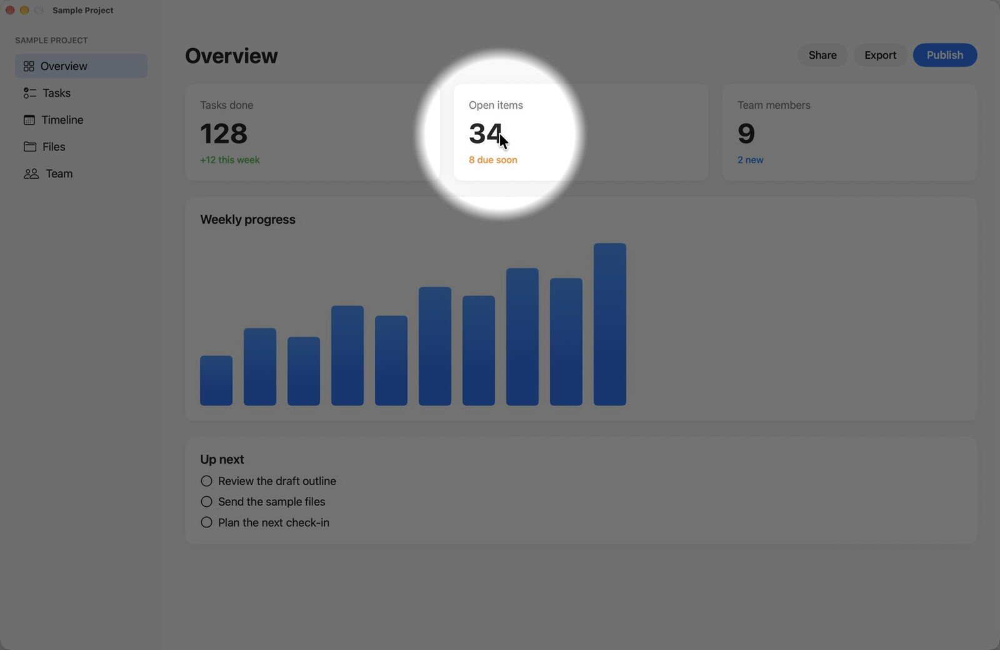
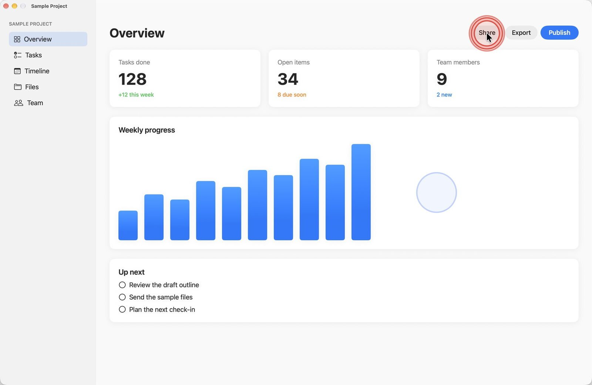
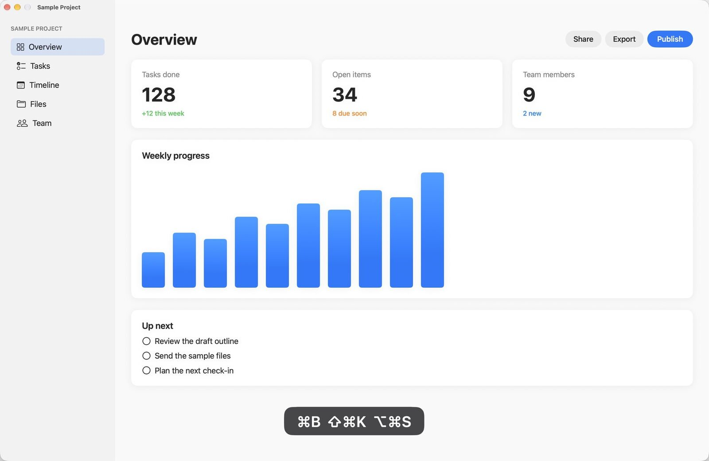
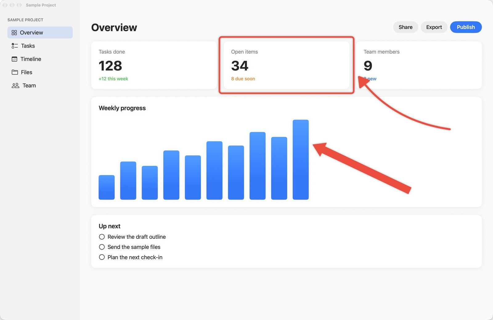
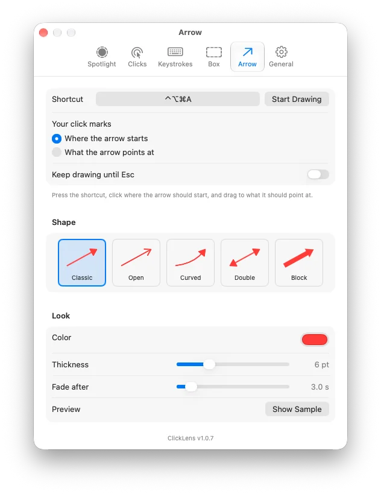

# ClickLens

ClickLens makes your pointer, clicks and keystrokes easy to follow when you present, demo or record your Mac screen. Press a shortcut and the screen dims around a spotlight that follows the pointer. Clicks draw colored rings, and the keys you press appear on screen.

<p align="center"></p>

## Download

**[⬇ Download ClickLens.dmg](https://github.com/smanke-org/ClickLens/releases/latest/download/ClickLens.dmg)**

1. Open the disk image and drag ClickLens to Applications.
2. Open ClickLens. It lives in the menu bar.
3. To show keystrokes, allow ClickLens in System Settings › Privacy & Security › Accessibility. The spotlight and click rings work without it.

Requires macOS 26 or later.

## Features

- **Spotlight** (⌃⌥⌘L): dims every screen except a circle around the pointer. You can set the radius, the soft edge, the dim color and strength, the zoom animation, and an automatic turn-off.
- **Click rings** (⌃⌥⌘C): a ring for each click, with separate colors for the left, right and other buttons, and double rings for double clicks. Rings can expand as they fade and play an optional click sound. They can show on their own or whenever the spotlight is on.
- **Keystrokes** (⌃⌥⌘K): keys shown at the bottom of the screen. Choose **Everything you type**, or **Key combinations only**, which shows only keys pressed with ⌘ ⌥ ⇧ or ⌃ (such as ⇧⌘K) and keeps ordinary typing private. Font size, background and fade time are adjustable, and you can pick which display it appears on.
- **Draw a box** (⌃⌥⌘B): click and drag to draw a colored box around anything on screen; when you let go, your Mac is back to normal. Turn on "Keep drawing until Esc" to draw several. Choose the line color, thickness, and how long each box stays before it fades.
- **Draw an arrow** (⌃⌥⌘A): click and drag to draw an arrow. Your click can mark where the arrow starts or what it points at. Choose from five shapes (classic, open, curved, double and block), the color, thickness, and how long it stays before it fades.
- Every effect can also be switched from a URL, for ToolHUD, Shortcuts or scripts: `clicklens://spotlight`, `clicks`, `keystrokes`, `box` and `arrow`. ToolHUD's buttons get a green light while their effect is on.
- Every shortcut can be changed, and ShortcutsLens lists them. An on-screen note can confirm each switch.
- Optional iCloud sync keeps settings the same on every Mac signed in to your iCloud account (through iCloud Drive; turn it on in Settings › General).
- Shows in the menu bar, the Dock, both, or neither. Can open at login. Checks GitHub for updates once a day (or as often as you choose, from every hour to once a year) and either asks first (the default) or installs them automatically when your Mac is idle and nothing is being presented. The update window shows what's new in the latest releases.

## Screenshots

<table>
<tr>
<td width="50%"><br><sub><b>Click rings.</b> A double ring for a double click, a different color for a right click.</sub></td>
<td width="50%"><br><sub><b>Keystrokes.</b> Key combinations shown at the bottom of the screen.</sub></td>
</tr>
<tr>
<td width="50%"><br><sub><b>Boxes and arrows.</b> Point at anything, then let it fade.</sub></td>
<td width="50%" align="center"><br><sub><b>Settings.</b> The Arrow tab, with five shapes to choose from.</sub></td>
</tr>
</table>

## Building

```bash
./build_app.sh   # universal binary, Developer ID signed
./install.sh     # copies to /Applications in place and launches
swift test       # ClickLensKit unit tests
./release.sh 1.0.1
```

## License

© 2026 Steve Manke. All rights reserved.
